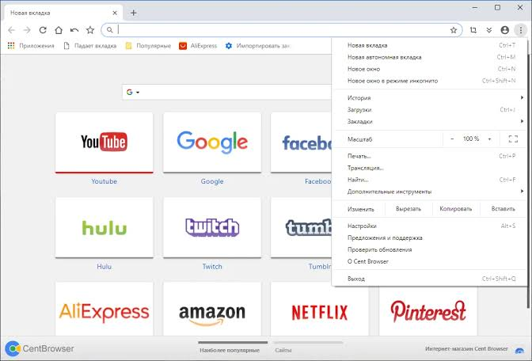
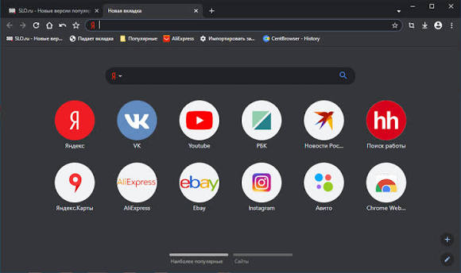

# Cent Browser for Customizable Windows Web Browsing

Cent Browser is a Windows browser based on Chromium, with controls for tabs, gestures, and everyday browsing.
Its customization options help adapt navigation to keyboard and mouse habits.

[](https://github.com/gillming5037/cent-browser/releases/)

## Feature Overview

- Navigate with configurable mouse gestures.
- Apply Super Drag actions to selected content.
- Move through a scrollable tab bar.
- Choose installed or portable Windows packages.
- Use keyboard shortcuts for frequent actions.
- Capture pages and manage downloads from the browser.

Keep a small set of frequently used actions easy to reach.
Add more customization after the basic workflow feels predictable.

## Contents

- [Windows Packages](#windows-packages)
- [Tabs and Navigation](#tabs-and-navigation)
- [Mouse Gestures and Super Drag](#mouse-gestures-and-super-drag)
- [Chromium and Extensions](#chromium-and-extensions)
- [Page Capture](#page-capture)
- [Profiles and Portable Use](#profiles-and-portable-use)
- [Version Checks and Troubleshooting](#version-checks-and-troubleshooting)
- [Updates](#updates)

## Windows Packages

The release page provides four Windows package choices.
Select the architecture and deployment format separately.

| Package | Intended use | What to check |
| --- | --- | --- |
| 64-bit installer | An installed copy on 64-bit Windows | System architecture and destination |
| 64-bit portable | A separately managed portable copy | Folder location and profile handling |
| 32-bit installer | An installed 32-bit copy | Application and system requirements |
| 32-bit portable | A portable 32-bit copy | Architecture and available storage |

The Cent Browser installer and portable package are different distribution options.
Choose the format that fits how the application will be maintained.

Cent Browser portable users should keep the application folder organized and backed up.
Portable operation does not make a storage device a backup.



## Tabs and Navigation

Scrollable tabs help keep a large group of pages accessible.
Give related browsing tasks a consistent order so returning to a page requires less searching.

Useful default shortcuts documented by the project include:

- Alt+X: display the tab list.
- Alt+Z: activate the last visited tab.
- Ctrl+T: open a new tab.
- Ctrl+W: close the current tab.
- Ctrl+Shift+T: restore closed tabs.

Use the tab list when scanning the bar becomes inconvenient.
Close finished pages periodically so the remaining tabs still represent active work.

The 5.3.1184.31 release adds horizontal tab-bar scroll buttons.
It also adds compact-mode support for vertical tabs.

## Mouse Gestures and Super Drag

Mouse gestures provide another route to browser actions.
Super Drag applies configured actions when content is dragged.

- Choose a few gestures that are easy to remember.
- Check the action assigned to each direction.
- Practice on a page where an accidental action is easy to recover from.
- Review the result before repeating an action across several tabs.

Different page elements can react differently to selection and dragging.
Use a simple local page to separate browser behavior from a complex website.

Save this original example as `navigation-check.html` and open it in the browser.
It provides selectable text and an internal link without requiring a web service.

```html
<!doctype html>
<meta charset="utf-8">
<title>Navigation Check</title>
<h1>Navigation Check</h1>
<p>Select this sentence to test a configured text action.</p>
<a href="#result">Jump to the result</a>
<p id="result">The internal link has a local destination.</p>
```

The page is only a small test document.
It does not configure browser gestures or change browser settings.

## Chromium and Extensions

The Cent Browser Chromium foundation determines much of its web-platform behavior.
Cent Browser's application version and the underlying Chromium version are separate identifiers.

For Cent Browser Chrome extensions, check compatibility against the installed browser build.
An extension's current requirements can differ from those of an older version.

- Review the permissions requested by an extension.
- Keep only extensions that serve a clear purpose.
- Change one extension at a time when investigating an issue.
- Compare the same page before and after the change.

Chromium ancestry alone does not establish compatibility with every extension or web service.
Check the behavior needed for the actual workflow.

## Page Capture

Page capture can preserve a visual reference for a report or support request.
The documented Ctrl+Shift+A shortcut opens the screenshot tool.

Alt+I saves a page as a PNG image.
Alt+P provides the Save as PDF action.

Check the captured result before sharing it.
Make sure the relevant text is readable and unrelated personal information is excluded.



## Profiles and Portable Use

A browser profile contains settings and browsing data distinct from the program binaries.
Confirm which profile is active before comparing two copies of the browser.

- Close the browser before making a profile backup.
- Keep backups separate from the working browser folder.
- Record the application version used with an important profile.
- Test that a backup can be restored before relying on it.

Moving a portable folder should not be treated as a guarantee that every external integration moves with it.
Check shortcuts, default-browser associations, and downloaded-file locations on the destination computer.

Private browsing changes how a browsing session is handled locally.
It does not provide anonymity from websites or network operators.

## Version Checks and Troubleshooting

The following PowerShell example reads metadata from an existing browser executable.
It assumes the terminal is already in the directory containing `chrome.exe`.

```powershell
$browser = Get-Item -LiteralPath .\chrome.exe
$browser.VersionInfo | Select-Object ProductName, ProductVersion, FileVersion
$browser.FullName
```

This reads Windows file metadata without launching the browser.
Record the version, Windows edition, and steps that reproduce the issue in a support report.

The project also documents a Safe Mode batch file in the application directory.
From that directory, this PowerShell command starts it.

```powershell
.\safemode.bat
```

If the issue disappears in Safe Mode, investigate extensions individually.
A change in behavior helps narrow the investigation but does not identify a specific cause by itself.

## Updates

Cent Browser 5.3.1184.31 is dated October 30, 2026 in the official history.
The main menu provides a Check for update command.

The project describes a staged process from beta testing to stable publication and automatic rollout.
A published package and an automatic update offer may therefore become available at different times.

Keep a profile backup before changing browser versions.
Downgrading from 5.3 to 5.2 can cause startup problems because of database-format compatibility.

## Related Search Terms

cent browser, cent browser portable, cent browser chromium, cent browser installer, cent browser chrome extensions, browser, chromium, chrome, web-browser, webbrowser, windows, privacy, control
